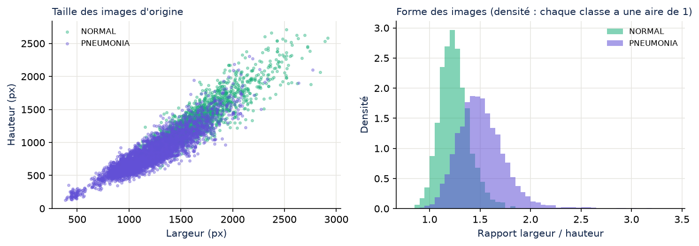
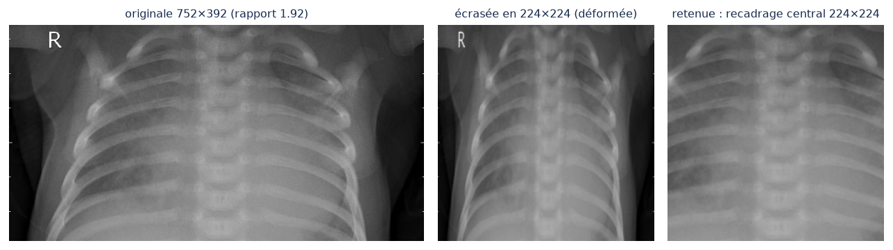
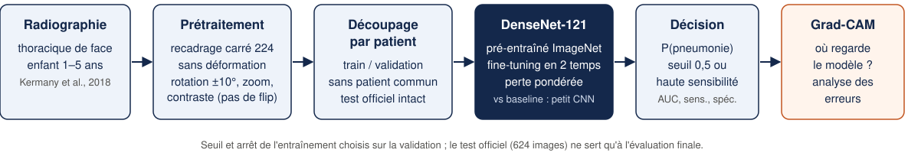
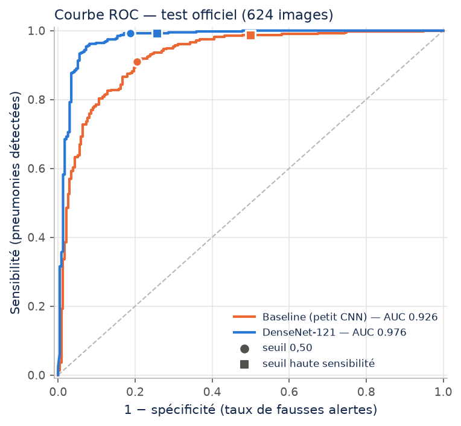
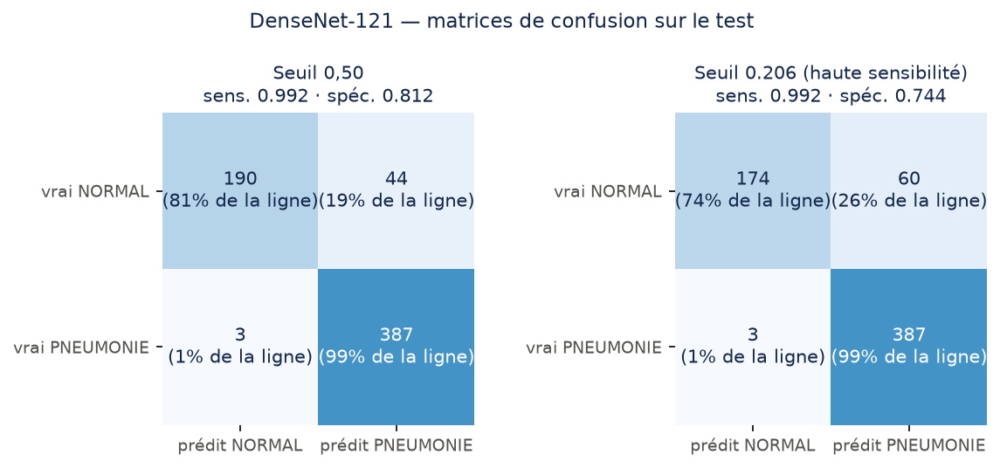
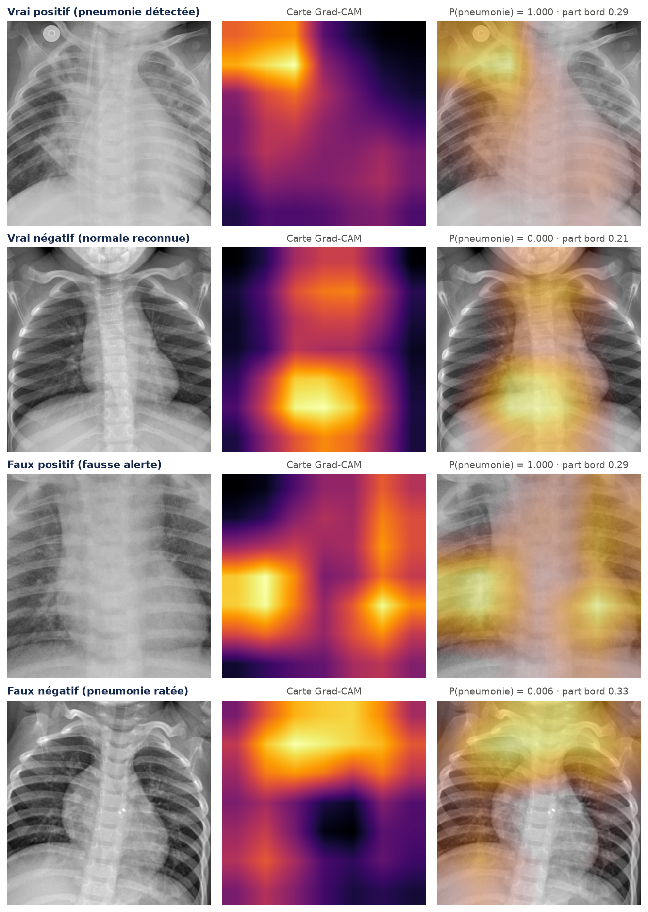
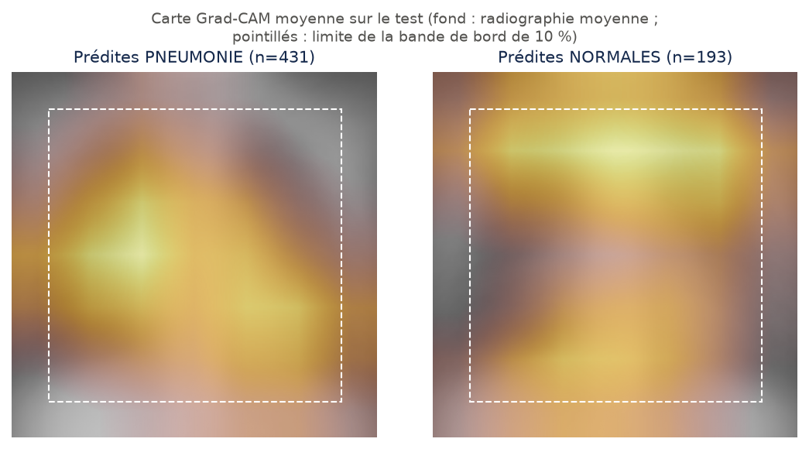

# IA explicable pour la détection de pneumonie sur radiographies thoraciques

> **English summary.** A personal project by Lamiae Andof. I fine-tuned an ImageNet-pretrained DenseNet-121 to
> classify paediatric chest X-rays as NORMAL or PNEUMONIA (Kermany et al., 2018), and compared it with a small CNN
> baseline. Validation is split by patient, the loss is class-weighted, and the official test set stays untouched
> until the end. On the 624 test images, DenseNet-121 reaches **AUC 0.976** [0.961–0.988], **sensitivity 0.992**
> (3 of 390 pneumonias missed) and **specificity 0.812** (44 false alarms out of 234 normals): false alarms are its
> weak point. Grad-CAM shows that the model mostly looks at the centre of the image, but also that an electrode lies
> in one hot area. I also found that **image shape alone predicts the class (AUC 0.87)**, so I centre-cropped the
> images instead of squashing them. **Educational project, not a diagnostic tool.**

> **Ce projet n'est pas un outil de diagnostic.** C'est un projet personnel et pédagogique, sans validation
> clinique. Le modèle ne doit servir à aucune décision médicale.

Portfolio et démonstration interactive : **https://lamiaeandof.github.io/radiographies.html**
Poster (1 page) : [poster/poster_Lamiae_Andof.pdf](poster/poster_Lamiae_Andof.pdf)

---

## 1. Objectif

J'ai voulu entraîner un réseau de neurones à reconnaître une pneumonie sur la radiographie d'un enfant. Je l'ai
ensuite évalué honnêtement, avec des métriques médicales, sur des images qu'il n'avait jamais vues. Enfin, j'ai
regardé **où il regarde** avec Grad-CAM, surtout quand il se trompe.

## 2. Données

*Chest X-Ray Images (Pneumonia)*, publié sur Kaggle par P. Mooney et issu de :
- Kermany D., Goldbaum M., Cai W. et al. *Identifying Medical Diagnoses and Treatable Diseases by Image-Based Deep
  Learning.* **Cell**, 2018; 172(5):1122-1131. doi:10.1016/j.cell.2018.02.010
- Kermany D. et al. *Large Dataset of Labeled OCT and Chest X-Ray Images*, Mendeley Data, V3,
  doi:10.17632/rscbjbr9sj.3, licence **CC BY 4.0**.

Le jeu contient 5 856 radiographies **d'enfants de 1 à 5 ans**, toutes du même hôpital (Guangzhou Women and
Children's Medical Center).

| Split officiel | Normales | Pneumonies | % pneumonie |
|---|---|---|---|
| train | 1 341 | 3 875 | 74,3 % |
| val | 8 | 8 | 50 % |
| test | 234 | 390 | 62,5 % |

Les images ne sont pas dans ce dépôt (voir [Reproduire le projet](#7-reproduire-le-projet)).

### Points traités (notebook 01)
- **Déséquilibre** : 74 % de pneumonies. J'ai donc utilisé une perte pondérée et des métriques médicales, pas
  l'accuracy seule.
- **Validation officielle de 16 images** : beaucoup trop petite. J'en ai recréé une à partir du train.
- **Fuite entre patients** : un même identifiant peut avoir jusqu'à 30 images. J'ai fait un découpage **par
  patient** (`StratifiedGroupKFold`, 1 pli sur 7), qui donne 0 patient commun entre train et validation. Un
  découpage image par image aurait mis 428 patients des deux côtés, soit 71 % des images de validation.
- **Identifiants non documentés** : j'ai regroupé de façon prudente les noms qui *pourraient* désigner le même
  enfant (`IM-0651` et `NORMAL2-IM-0651`, `person1_bacteria` et `person1_virus`). Regrouper à tort ne crée jamais
  de fuite.
- **Test officiel** : 264 identifiants apparaissent aussi dans le train. Mais pour les 170 identifiants de
  pneumonie concernés, le sous-type est toujours différent (0 % d'accord contre 43 % attendus si c'étaient les
  mêmes enfants). La numérotation semble donc indépendante entre les splits. Je ne peux pas le vérifier ; j'ai
  gardé le test officiel intact.

### Le piège : la forme des images



Les images de pneumonie sont plus larges (rapport largeur/hauteur médian de 1,49 contre 1,23). **Ce seul nombre,
sans regarder la radio, prédit la pneumonie avec une AUC de 0,865 sur le train** (0,704 sur le test). C'est un
indice d'acquisition, pas un signe médical. Écraser les images en carré aurait transformé cette forme en
déformation du thorax, un raccourci facile pour le modèle. J'ai donc choisi **petit côté à 224 px, puis recadrage
central**, sans déformation.



## 3. Méthode



- **Prétraitement** : niveaux de gris, recadrage central 224×224, 3 canaux, normalisation ImageNet.
- **Augmentations réalistes** : rotation de ±10°, translation de 5 %, zoom de ±5 %, luminosité et contraste
  ±10 %. Pas de flip : le cœur est à gauche, et une radio n'est jamais à l'envers.
- **Perte pondérée** : `BCEWithLogitsLoss(pos_weight = n_normales / n_pneumonies = 0,347)`.
- **Baseline** : un petit CNN (4 blocs convolutifs, 97 809 paramètres), entraîné de zéro sur CPU (15 époques).
- **Modèle principal** : DenseNet-121 pré-entraîné sur ImageNet, la référence de CheXNet. L'entraînement se fait
  en deux temps : d'abord la tête seule (2 époques, lr 1e-3), puis tout le réseau (8 époques, lr 1e-4, cosinus).
  J'ai gardé la meilleure époque selon l'**AUC de validation**.
- **Machine** : un GPU NVIDIA MX330 avec 2 Go. DenseNet-121 n'y tenait pas en mémoire. Je l'ai entraîné grâce à
  la précision mixte (AMP) et au *checkpointing* (`memory_efficient=True`), en 43,6 min.
- **Seuil** : je compare le seuil 0,5 avec un seuil « haute sensibilité », fixé **à l'avance sur la validation**
  pour détecter au moins 98 % des pneumonies, puis appliqué tel quel au test.
- **Incertitude** : intervalles de confiance à 95 % par bootstrap (2 000 tirages du test).
- **Graine fixe** (42) et découpage sauvegardé dans [results/split.csv](results/split.csv).

## 4. Résultats (test officiel, 624 images)

| Modèle | Seuil | AUC-ROC | Sensibilité | Spécificité | Précision | F1 | Pneumonies ratées | Fausses alertes |
|---|---|---|---|---|---|---|---|---|
| Baseline (petit CNN) | 0,50 | 0,926 [0,902–0,947] | 0,910 [0,880–0,937] | 0,795 [0,741–0,846] | 0,881 | 0,895 | 35 | 48 |
| Baseline (petit CNN) | 0,092 (haute sens.) | 0,926 | 0,987 [0,976–0,997] | 0,500 [0,437–0,563] | 0,767 | 0,863 | 5 | 117 |
| **DenseNet-121** | **0,50** | **0,976 [0,961–0,988]** | **0,992 [0,982–1,000]** | **0,812 [0,760–0,860]** | 0,898 | 0,943 | **3** | **44** |
| DenseNet-121 | 0,206 (haute sens.) | 0,976 | 0,992 [0,982–1,000] | 0,744 [0,683–0,797] | 0,866 | 0,925 | 3 | 60 |

*Tableau complet, avec accuracy : [results/tableau_resultats.md](results/tableau_resultats.md). Métriques brutes :
[results/metriques.json](results/metriques.json).*

<p> </p>

Ce que j'en retiens :
- **Le pré-entraînement aide nettement** : AUC de 0,976 contre 0,926 (les intervalles ne se chevauchent pas), et
  3 pneumonies ratées au lieu de 35.
- **Le point faible du DenseNet, ce sont les fausses alertes.** En validation, la spécificité était de 0,995 et
  l'AUC de 0,999 ; sur le test, elles tombent à 0,812 et 0,976. Presque toutes les erreurs du test sont des radios
  normales classées « pneumonie » : 81,2 % des normales sont bien classées, contre 99,2 % des pneumonies
  bactériennes et 99,3 % des virales. Le test ne ressemble donc pas tout à fait au train (voir
  [figures/distribution_probas.png](figures/distribution_probas.png)).
- **Le seuil « haute sensibilité » n'apporte rien au DenseNet sur ce test.** La sensibilité était déjà de 0,992,
  et ce seuil ajoute 16 fausses alertes. Pour la baseline, en revanche, l'arbitrage est net : de 35 à 5 pneumonies
  ratées, mais de 48 à 117 fausses alertes. Un seuil se choisit selon l'usage, et sur des données représentatives.

## 5. Explicabilité (Grad-CAM)

J'ai appliqué Grad-CAM (Selvaraju et al., 2017) sur la dernière couche convolutive du DenseNet-121
(`features.norm5`, 7×7), avec la bibliothèque `pytorch-grad-cam`. La carte explique toujours la **classe
prédite**.



Mes lectures restent prudentes, car je ne suis pas radiologue :
1. **Pneumonie détectée** (`person87_bacteria_434`, P = 1,000) : la zone chaude couvre le haut du poumon droit,
   où se trouve aussi une **électrode**. À cette résolution, je ne peux pas dire lequel des deux a compté.
2. **Normale reconnue** (`IM-0070-0001`, P = 0,000) : pour dire « normal », le modèle regarde le cœur et le cou,
   pas les poumons. C'est moins intuitif.
3. **Fausse alerte** (`NORMAL2-IM-0256-0001`, P = 1,000) : l'image est grise et peu contrastée, et la carte
   couvre les deux poumons. Mon hypothèse : ce voile ressemble à des opacités pour le modèle.
4. **Pneumonie ratée** (`person154_bacteria_728`, P = 0,006) : pour un œil non médical, les poumons paraissent
   normaux, et la carte regarde le cou. Anomalie subtile ou étiquette discutable ? Seul un radiologue pourrait
   trancher.

**Recherche de raccourcis sur les 624 cartes.** En moyenne, 24,7 % de la carte tombe dans la bande de bord
(10 % de chaque côté), alors qu'une carte uniforme y mettrait 36 %. Seules 2 cartes sur 624 regardent surtout
les bords, et ce sont des cas incertains. Pour les pneumonies prédites, la carte moyenne est sur les poumons.



Grad-CAM et Grad-CAM++ donnent des cartes presque identiques
([figures/gradcam_vs_gradcampp.png](figures/gradcam_vs_gradcampp.png)). D'autres figures sont disponibles :
erreurs ([gradcam_erreurs.png](figures/gradcam_erreurs.png)) et cartes tournées vers les bords
([gradcam_bords.png](figures/gradcam_bords.png)).

## 6. Limites et usage responsable

- **Population limitée** : des enfants de 1 à 5 ans, un seul hôpital. Rien ne garantit les performances sur
  d'autres hôpitaux, d'autres appareils ou des adultes.
- **Décalage validation / test** : la spécificité chute de 0,995 à 0,812. La validation, tirée du train, ne
  représente pas bien le test.
- **Étiquettes** : le modèle ne distingue pas pneumonie virale et bactérienne, et ne connaît aucune autre
  maladie. Certaines erreurs pourraient venir d'étiquettes discutables, ce que je ne peux pas vérifier.
- **Identifiants patients** non documentés : mon regroupement est prudent, mais je ne peux pas tout vérifier.
- **Raccourcis** : j'ai neutralisé la forme des images, mais d'autres différences d'acquisition (contraste,
  marqueurs, électrodes) peuvent subsister, comme l'a montré Zech et al. (2018).
- **Grad-CAM** est grossier (7×7) : il montre *où* le modèle regarde, pas *ce qu'il* y voit. Ce n'est pas une
  localisation de lésion validée.
- **Entraînement court**, adapté à un GPU de 2 Go. La baseline progressait encore à la dernière époque.
- **Aucune validation clinique : ce n'est pas un dispositif médical.**

## 7. Reproduire le projet

```bash
# 1. Environnement (Python 3.12)
python -m venv .venv && .venv\Scripts\activate            # Windows (Linux/macOS : source .venv/bin/activate)
pip install torch==2.5.1 torchvision==0.20.1 --index-url https://download.pytorch.org/whl/cu118   # ou sans --index-url pour le CPU
pip install -r requirements.txt
pip install --no-deps grad-cam==1.5.4

# 2. Données (nécessite un kaggle.json, à ne jamais publier)
kaggle datasets download -d paultimothymooney/chest-xray-pneumonia -p data/raw
python -m src.data                      # extraction, découpage par patient, cache 224x224

# 3. Entraînement
python -m src.train --modele densenet121 --epochs-tete 2 --lr-tete 1e-3 --epochs 8 --lr 1e-4 --patience 3 --batch 16 --amp
python -m src.train --modele baseline --epochs 15 --lr 1e-3 --patience 4 --batch 32 --cpu

# 4. Évaluation et explicabilité (ou exécuter les notebooks 03 et 04)
python -m src.evaluate
python -m src.gradcam
```

| Fichier | Rôle |
|---|---|
| [notebooks/01_exploration.ipynb](notebooks/01_exploration.ipynb) | comptes, exemples, tailles, identifiants patients, piège de la forme, découpage |
| [notebooks/02_entrainement.ipynb](notebooks/02_entrainement.ipynb) | augmentations, journaux réels, courbes d'apprentissage |
| [notebooks/03_evaluation.ipynb](notebooks/03_evaluation.ipynb) | métriques, intervalles de confiance, seuil, ROC |
| [notebooks/04_explicabilite.ipynb](notebooks/04_explicabilite.ipynb) | Grad-CAM, erreurs, recherche de raccourcis |
| `src/` | code réutilisable (données, modèles, entraînement, évaluation, Grad-CAM) |
| `app/demo_gradio.py` | petite démo locale (optionnelle, non testée, avec avertissement) |
| `poster/` | poster A4 (HTML → PDF) et export des visuels |
| [JOURNAL.md](JOURNAL.md) | journal daté : problèmes rencontrés et décisions |

Les poids des modèles (`models/*.pt`) ne sont pas publiés : on les régénère avec les commandes ci-dessus. Sur GPU,
de petites différences numériques sont possibles d'une machine à l'autre.

## 8. Ce que ce projet m'a appris, et ce qui me manque encore

- Un score élevé en validation ne suffit pas : ici, il cachait un écart réel avec le test.
- Explorer les données avant d'entraîner évite des pièges. Sans l'exploration, je n'aurais pas vu que la forme
  des images trahissait la classe.
- Découper par patient, fixer le seuil sur la validation et donner des intervalles de confiance sont des gestes
  simples, mais indispensables.
- **Ce qui me manque** : la connaissance clinique. Sans elle, je ne peux pas dire si une fausse alerte vient du
  modèle ou de l'image, ni juger si une zone Grad-CAM a un sens médical. C'est ce que je veux acquérir dans un
  master en IA appliquée à la santé et à l'imagerie médicale.

## Sources

**Données** : Kermany et al., *Cell* 2018 (doi:10.1016/j.cell.2018.02.010) ; Mendeley Data
doi:10.17632/rscbjbr9sj.3 (CC BY 4.0) ; Kaggle, P. Mooney,
https://www.kaggle.com/datasets/paultimothymooney/chest-xray-pneumonia

**Méthodes**
- Selvaraju R. R. et al., *Grad-CAM: Visual Explanations from Deep Networks via Gradient-based Localization*,
  ICCV 2017. https://arxiv.org/abs/1610.02391
- Chattopadhay A. et al., *Grad-CAM++*, WACV 2018. https://arxiv.org/abs/1710.11063
- Gildenblat J. et al., *pytorch-grad-cam*. https://github.com/jacobgil/pytorch-grad-cam
- Huang G. et al., *Densely Connected Convolutional Networks*, CVPR 2017. https://arxiv.org/abs/1608.06993
- Rajpurkar P. et al., *CheXNet*, 2017. https://arxiv.org/abs/1711.05225
- Zech J. R. et al., *Variable generalization performance of a deep learning model to detect pneumonia in chest
  radiographs*, PLOS Medicine, 2018. https://doi.org/10.1371/journal.pmed.1002683

**Outils** : PyTorch / torchvision, scikit-learn, pandas, NumPy, matplotlib, pytorch-grad-cam, three.js (portfolio).
